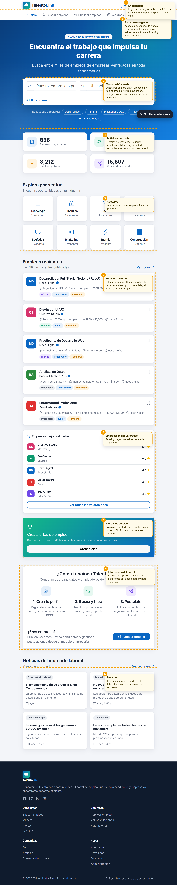
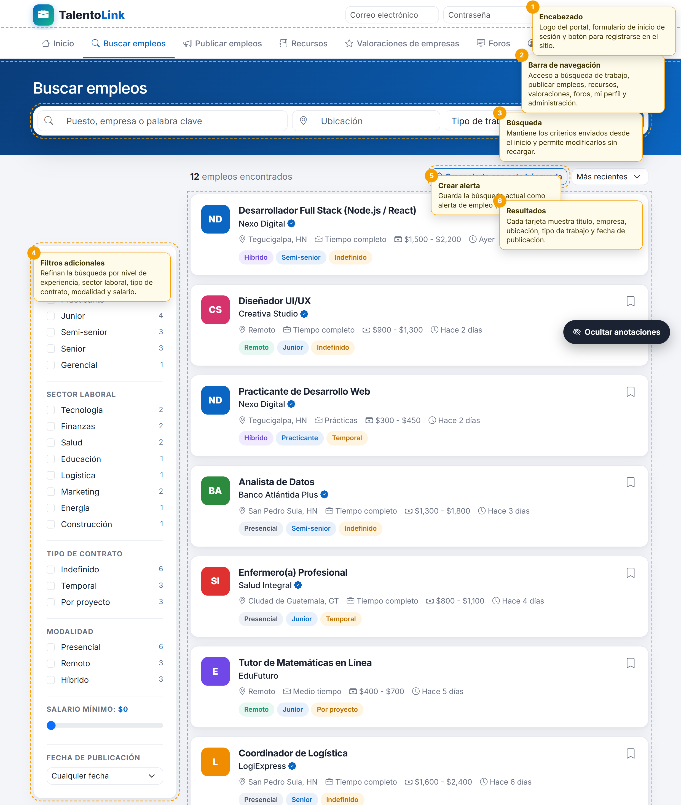
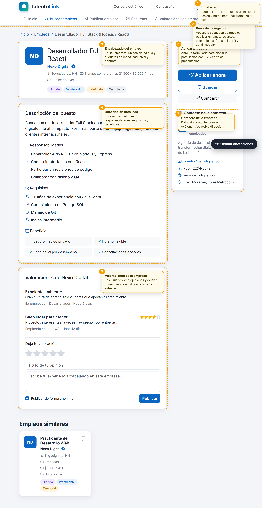
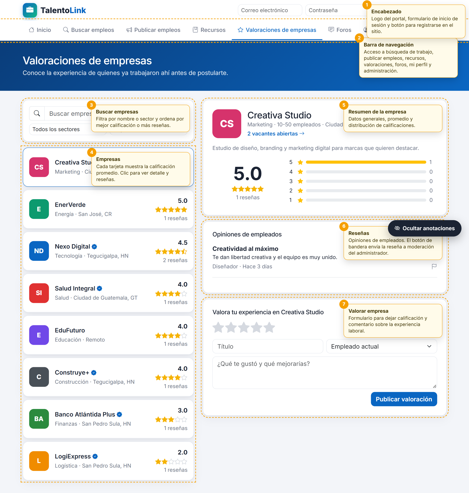
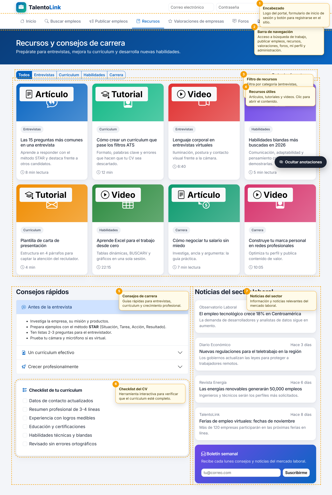
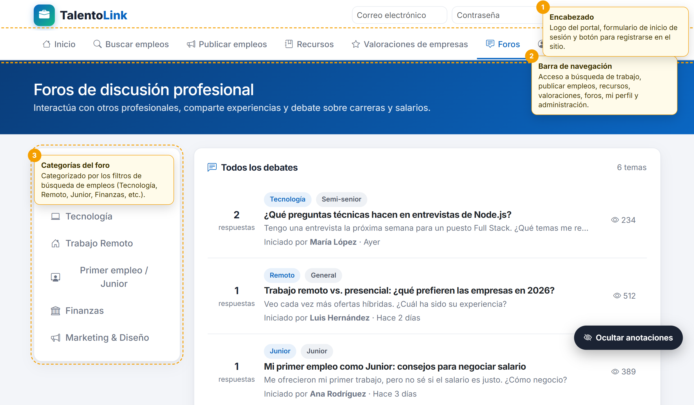
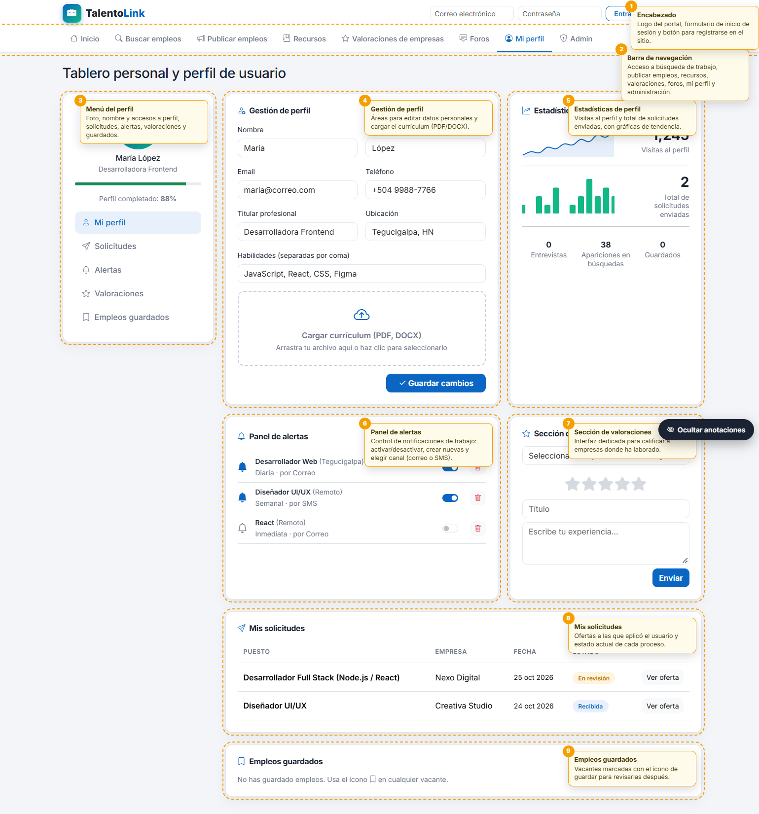
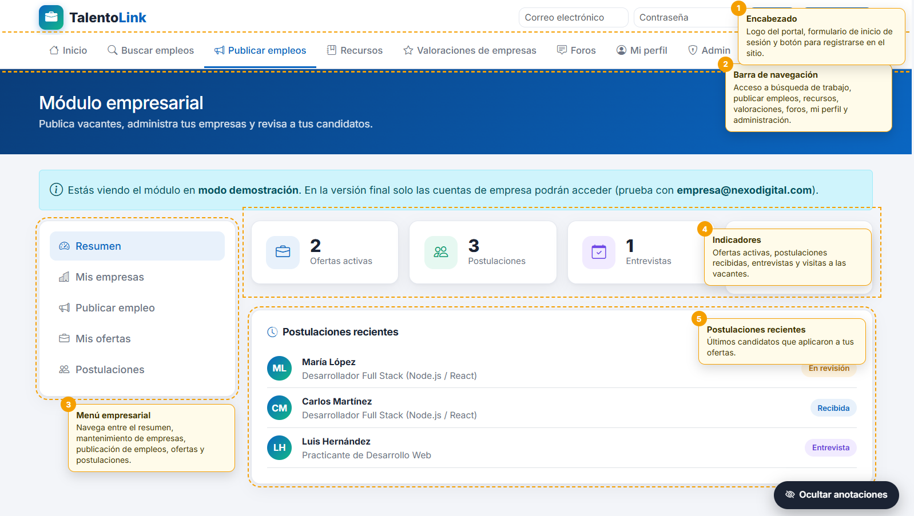
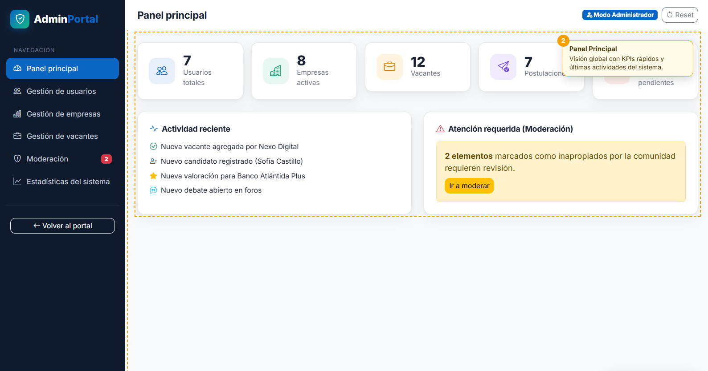

# DOCUMENTO DE DISEÑO Y PROYECTO: CHAMBEASV
## Portal Web de Búsqueda y Gestión de Empleo

---

### PORTADA

* **Nombre del Proyecto:** ChambeaSV – Portal de Búsqueda y Gestión de Empleo
* **Asignatura:** Programación Web
* **Entrega:** Primer Avance – Prototipo de Interfaz de Usuario (UI/UX)
* **Integrantes del Equipo:**
  * [Nombre del Estudiante 1]
  * [Nombre del Estudiante 2]
* **Docente:** [Nombre del Docente]
* **Fecha de Entrega:** Miércoles, [Fecha]
* **Repositorio de GitHub:** [Enlace a tu repositorio]

---

## 1. INTRODUCCIÓN Y JUSTIFICACIÓN DEL DISEÑO

### 1.1 Objetivo del Proyecto
Desarrollar un prototipo funcional para un portal de búsqueda de empleo en línea inspirado en plataformas de referencia como LinkedIn, que conecte de manera bidireccional y eficiente a **postulantes/candidatos** con **empresas/empleadores**, ofreciendo además herramientas de preparación profesional, foros comunitarios y un módulo de gobernanza y moderación administrativa.

### 1.2 Justificación del Diseño Visual y de Experiencia (UI/UX)
* **Paleta de Colores Corporativa:** Se seleccionó el azul `#0a66c2` como color primario institucional (asociado a confianza, seriedad y entorno profesional corporativo), combinado con verde menta `#12b886` para llamadas a la acción positivas (aplicaciones exitosas, badges) y tonos neutros claros (`#f3f5f9`) para asegurar un alto contraste y legibilidad prolongada.
* **Tipografía:** Se implementó la fuente **Inter** de Google Fonts, estándar en aplicaciones SaaS modernas por su legibilidad en pantallas retina y soporte tipográfico para números y tablas.
* **Componentes y Sistema de Diseño:** Construido sobre **Bootstrap 5.3**, complementado con hojas de estilo personalizadas que agregan micro-interacciones sutiles en tarjetas (`hover`, elevación mediante sombras suaves), modales limpios y gráficos dinámicos generados con **Chart.js**.
* **Navegación Unificada:** Barra superior fija (*sticky navbar*) visible en todas las pantallas públicas, asegurando que el usuario nunca pierda el acceso a búsqueda, recursos, foros o su cuenta.

---

## 2. ARQUITECTURA DE INFORMACIÓN Y MAPA DEL SITIO

### 2.1 Mapa del Sitio (Sitemap)

```
T-SEARCH
│
├── 1. MÓDULO PÚBLICO / VISITANTE
│   ├── PAN-PUB-01: Página de Inicio (index.html)
│   ├── PAN-PUB-02: Búsqueda y Resultados de Empleo (empleos.html)
│   ├── PAN-PUB-03: Ficha Detallada del Empleo (empleo.html)
│   ├── PAN-PUB-04: Directorio y Valoraciones de Empresas (valoraciones.html)
│   ├── PAN-PUB-05: Centro de Recursos y Consejos (recursos.html)
│   └── PAN-PUB-06: Foros de Discusión Profesional (foros.html)
│
├── 2. MÓDULO CANDIDATO / POSTULANTE
│   ├── PAN-CAN-01: Tablero Personal y Perfil (perfil.html#gestion)
│   ├── PAN-CAN-02: Mis Estadísticas y Postulaciones (perfil.html#solicitudes)
│   ├── PAN-CAN-03: Gestión de Alertas Laborales (perfil.html#alertas)
│   └── PAN-CAN-04: Valorar Empresa Laborada (perfil.html#valoraciones)
│
├── 3. MÓDULO EMPRESARIAL / RECLUTADOR
│   ├── PAN-EMP-01: Tablero de Mando Empresarial (empresa.html#resumen)
│   ├── PAN-EMP-02: Mantenimiento de Empresas / CRUD (empresa.html#empresas)
│   ├── PAN-EMP-03: Publicación de Vacantes (empresa.html#publicar)
│   ├── PAN-EMP-04: Gestión de Ofertas y Candidatos (empresa.html#postulaciones)
│   └── PAN-EMP-05: Modal de Revisión de Perfil de Candidato (modal)
│
└── 4. MÓDULO ADMINISTRATIVO
    ├── PAN-ADM-01: Panel de Control Principal (admin.html#principal)
    ├── PAN-ADM-02: Gestión y Auditoría de Usuarios (admin.html#usuarios)
    ├── PAN-ADM-03: Verificación y Gestión de Empresas (admin.html#empresas)
    ├── PAN-ADM-04: Supervisión de Vacantes (admin.html#vacantes)
    ├── PAN-ADM-05: Centro de Moderación de Contenido (admin.html#moderacion)
    └── PAN-ADM-06: Métricas y Estadísticas Globales (admin.html#estadisticas)
```

---

## 3. FLUJO DE NAVEGACIÓN GENERAL

```
[Visitante / Candidato]
      │
      ├──> Ingresa a [PAN-PUB-01: Inicio]
      │         │
      │         ├──> Realiza Búsqueda con Filtros ──> [PAN-PUB-02: Resultados]
      │         │                                              │
      │         │                                              └──> Clic en Oferta ──> [PAN-PUB-03: Detalle de Empleo]
      │         │                                                                             │
      │         │                                                                             └──> Botón "Aplicar" ──> [Modal de Postulación]
      │         │
      │         ├──> Consulta [PAN-PUB-04: Valoraciones]
      │         ├──> Consulta [PAN-PUB-05: Recursos y Noticias]
      │         └──> Participa en [PAN-PUB-06: Foros de Debate]
      │
      └──> Inicia Sesión / Registro
                │
                ├── Si Rol = "Candidato" ──> [PAN-CAN-01: Tablero Personal y Perfil]
                │
                ├── Si Rol = "Empresa"   ──> [PAN-EMP-01: Módulo Empresarial]
                │
                └── Si Rol = "Admin"     ──> [PAN-ADM-01: Panel Administrativo]
```

---

## 4. NOMENCLATURA UNIFORME DE PANTALLAS Y TIPOS DE USUARIO

| Código de Pantalla | Nombre de Pantalla | Archivo Fuente | Rol / Tipo de Usuario Permitido |
| :--- | :--- | :--- | :--- |
| **PAN-PUB-01** | Inicio / Landing Page | `index.html` | Visitante, Candidato, Empresa |
| **PAN-PUB-02** | Búsqueda y Resultados | `empleos.html` | Visitante, Candidato, Empresa |
| **PAN-PUB-03** | Ficha de Empleo y Postulación | `empleo.html` | Visitante, Candidato |
| **PAN-PUB-04** | Directorio y Valoraciones | `valoraciones.html` | Visitante, Candidato, Empresa |
| **PAN-PUB-05** | Recursos y Noticias | `recursos.html` | Visitante, Candidato |
| **PAN-PUB-06** | Foros de Discusión | `foros.html` | Visitante, Candidato, Empresa |
| **PAN-CAN-01** | Tablero Personal y Perfil | `perfil.html` | Candidato |
| **PAN-EMP-01** | Módulo Empresarial | `empresa.html` | Empresa / Reclutador, Admin |
| **PAN-ADM-01** | Panel Administrativo | `admin.html` | Administrador del Sistema |

---

## 5. CATÁLOGO DETALLADO DE PANTALLAS POR MÓDULO

---

### MÓDULO 1: PORTAL PÚBLICO Y BÚSQUEDA

#### Pantalla 1.1: Inicio / Landing Page
* **Código:** `PAN-PUB-01`
* **Archivo:** `public/index.html`
* **Tipo de Usuario:** Público en general (Visitantes, Candidatos y Empleadores).
* **Objetivo:** Servir como punto de entrada a la plataforma, facilitando la búsqueda rápida de empleo mediante palabras clave y filtros primarios, al tiempo que presenta métricas de impacto y empresas destacadas.
* **Funcionamiento y Lógica:**
  1. **Barra de navegación:** Permite acceso directo a cada sección del sitio y modales de autenticación.
  2. **Buscador Hero con Filtros Avanzados:** Entrada de texto predictiva para palabras clave, ubicación y tipo de trabajo; desplegable con filtros avanzados (salario mínimo, modalidad, nivel). Al enviar, redirige a `empleos.html` con parámetros URL.
  3. **Métricas en tiempo real:** Muestra conteos interactivos con animación de incremento de vacantes, usuarios, empresas registradas y postulaciones.
  4. **Categorías por Sector y Top Empresas:** Accesos rápidos filtrados por industria y ranking de empresas mejor evaluadas según sus calificaciones.
* **Captura de Pantalla:**
  > *(Inserta aquí la captura de la pantalla de Inicio)*
  > 

---

#### Pantalla 1.2: Resultados de Búsqueda y Filtros
* **Código:** `PAN-PUB-02`
* **Archivo:** `public/empleos.html`
* **Tipo de Usuario:** Candidatos y Visitantes.
* **Objetivo:** Brindar un motor de búsqueda refinado con múltiples criterios simultáneos para encontrar vacantes laborales pertinentes.
* **Funcionamiento y Lógica:**
  1. **Sincronización bidireccional de parámetros:** Lee los términos provenientes del formulario de inicio o permite buscar sin recargar la página.
  2. **Barra lateral de filtros acumulativos:** Checkboxes dinámicos por nivel de experiencia, sector económico, tipo de contrato y modalidad de trabajo (presencial/remoto/híbrido).
  3. **Control de rango salarial:** Slider interactivo que actualiza el umbral salarial mínimo en tiempo real.
  4. **Tarjeta de Empleo:** Muestra cargo, empresa, ubicación, modalidad (chip de color), salario estimado y fecha relativa ("Hace 2 días"). Cuenta con botón para guardar la vacante y acceso al detalle.
  5. **Creación de Alertas:** Permite guardar la combinación actual de búsqueda como una alerta automática vinculada al perfil del usuario.
* **Captura de Pantalla:**
  > *(Inserta aquí la captura de la pantalla de Búsqueda y Filtros)*
  > 

---

#### Pantalla 1.3: Ficha Detallada del Empleo
* **Código:** `PAN-PUB-03`
* **Archivo:** `public/empleo.html`
* **Tipo de Usuario:** Candidatos y Visitantes.
* **Objetivo:** Mostrar toda la información descriptiva y requisitos de una oferta laboral específica, y gestionar el envío de postulaciones.
* **Funcionamiento y Lógica:**
  1. **Carga dinámica por ID:** Extrae el identificador de la oferta desde la URL (`?id=X`) y carga los datos de la vacante y empresa asociada.
  2. **Bloques descriptivos:** Listas estructuradas de responsabilidades, requisitos técnicos/académicos y beneficios corporativos.
  3. **Tarjeta de contacto y empresa:** Resumen corporativo, enlaces web, teléfono institucional y correo directo.
  4. **Acción de Aplicar (Modal):** Despliega formulario para adjuntar currículum (PDF/DOCX) y redactar carta de presentación. Al enviar, registra la postulación con estado "Recibida".
  5. **Sección de opiniones:** Muestra reseñas de empleados sobre la empresa ofertante y permite dejar nuevas calificaciones con sistema de 5 estrellas.
* **Captura de Pantalla:**
  > *(Inserta aquí la captura de la pantalla de Detalle del Empleo)*
  > 

---

#### Pantalla 1.4: Directorio y Valoraciones de Empresas
* **Código:** `PAN-PUB-04`
* **Archivo:** `public/valoraciones.html`
* **Tipo de Usuario:** Público, Candidatos y Empleadores.
* **Objetivo:** Ofrecer transparencia laboral mediante opiniones, reseñas y calificaciones anónimas otorgadas por empleados y ex-empleados.
* **Funcionamiento y Lógica:**
  1. **Directorio segmentado:** Lista de empresas con cálculo automático del promedio de satisfacción (1 a 5 estrellas) y número total de opiniones.
  2. **Detalle analítico:** Al seleccionar una empresa, se muestra un desglose porcentual de valoraciones mediante barras de progreso distribuidas del 1 al 5.
  3. **Formulario de calificación:** Permite seleccionar la relación laboral (empleado actual, ex-empleado, postulante) y redactar pros y contras.
  4. **Herramienta de reporte (Bandera):** Los usuarios pueden reportar opiniones ofensivas o sospechosas para que sean derivadas al panel de moderación del administrador.
* **Captura de Pantalla:**
  > *(Inserta aquí la captura de la pantalla de Valoraciones)*
  > 

---

#### Pantalla 1.5: Recursos y Consejos de Carrera
* **Código:** `PAN-PUB-05`
* **Archivo:** `public/recursos.html`
* **Tipo de Usuario:** Candidatos y Estudiantes.
* **Objetivo:** Dotar a los usuarios de herramientas formativas, guías para entrevistas, optimización de CV y noticias de empleabilidad.
* **Funcionamiento y Lógica:**
  1. **Filtrado por formato y temática:** Artículos de lectura, tutoriales interactivos y cápsulas en video organizados por etiquetas (Entrevistas, Currículum, Habilidades, Negociación).
  2. **Modal interactivo de contenido:** Permite leer la guía completa o visualizar el reproductor de video simulado.
  3. **Checklist del Currículum:** Lista de cotejo interactiva (6 puntos esenciales) que guarda el progreso del candidato localmente en el navegador.
  4. **Sección informativa de noticias:** Artículos breves con fuentes y fechas de actualización sobre el mercado de trabajo regional.
* **Captura de Pantalla:**
  > *(Inserta aquí la captura de la pantalla de Recursos)*
  > 

---

#### Pantalla 1.6: Foros de Discusión Profesional
* **Código:** `PAN-PUB-06`
* **Archivo:** `public/foros.html`
* **Tipo de Usuario:** Comunidad en general (Candidatos, Profesionales y Empresas).
* **Objetivo:** Fomentar el networking y el intercambio de conocimientos y experiencias sobre entrevistas, sueldos y crecimiento profesional.
* **Funcionamiento y Lógica:**
  1. **Categorización temática:** Foros divididos por sectores alineados a la búsqueda de empleo (Tecnología, Trabajo Remoto, Salarios Junior, Finanzas, etc.).
  2. **Creación de temas:** Modal para iniciar debates con título, categoría, nivel de experiencia y descripción del hilo.
  3. **Visualización y respuestas en hilo:** Contador de vistas y respuestas; ventana modal que permite leer la conversación completa y emitir comentarios que se integran en tiempo real.
* **Captura de Pantalla:**
  > *(Inserta aquí la captura de la pantalla de Foros)*
  > 

---

### MÓDULO 2: TABLERO PERSONAL Y PERFIL DEL CANDIDATO

#### Pantalla 2.1: Tablero Personal y Perfil de Usuario
* **Código:** `PAN-CAN-01`
* **Archivo:** `public/perfil.html`
* **Tipo de Usuario:** Candidato / Postulante registrado.
* **Objetivo:** Brindar un panel de control integral para administrar la información personal, currículum vitae, métricas de visibilidad, alertas y seguimiento de solicitudes enviadas. *(Diseño fiel al esquema del entregable docente)*.
* **Funcionamiento y Lógica:**
  1. **Gestión de Perfil:** Edición de nombres, correo, teléfono, titular ocupacional y habilidades técnicas.
  2. **Área de Carga de CV (Dropzone):** Soporte visual para arrastrar y soltar archivos PDF y DOCX con validación de extensiones y cálculo automático del porcentaje de completitud del perfil.
  3. **Estadísticas de Perfil con Gráficos:** Visualización de métricas de visitas al perfil (gráfico de línea) y total de postulaciones emitidas (gráfico de barras) renderizados mediante Chart.js.
  4. **Panel de Alertas Laborales:** Listado de notificaciones configuradas por el usuario con interruptores directos (*toggle switches*) para activar o suspender avisos vía Correo o SMS.
  5. **Sección de Valoraciones:** Acceso directo para que el candidato emita reseñas sobre las organizaciones donde ha prestado servicios.
  6. **Mis Solicitudes y Guardados:** Tablas de seguimiento con estados dinámicos del proceso de reclutamiento (*Recibida*, *En revisión*, *Entrevista*, *Contratado*, *Rechazada*).
* **Captura de Pantalla:**
  > *(Inserta aquí la captura de la pantalla de Perfil de Usuario)*
  > 

---

### MÓDULO 3: MÓDULO EMPRESARIAL (RECLUTADORES)

#### Pantalla 3.1: Módulo Empresarial y Gestión de Empleos
* **Código:** `PAN-EMP-01`
* **Archivo:** `public/empresa.html`
* **Tipo de Usuario:** Empresas, Reclutadores y Recursos Humanos.
* **Objetivo:** Centralizar el mantenimiento corporativo, publicación de vacantes y evaluación de candidatos postulados.
* **Funcionamiento y Lógica:**
  1. **Resumen y KPIs:** Indicadores de vacantes activas, total de postulaciones recibidas, entrevistas coordinadas y visitas registradas.
  2. **Mantenimiento (CRUD) de Empresas:** Creación, edición de datos corporativos (logo institucional, descripción, empleados, contacto) y eliminación.
  3. **Formulario de Publicación de Vacantes:** Registro estructurado de título, modalidad, sector, rango salarial, requisitos detallados y beneficios laborales. Al publicarse, la oferta pasa automáticamente a estar visible en el buscador principal.
  4. **Consulta y Gestión de Postulaciones:** Selección por vacante para listar candidatos, inspeccionar su currículum y modificar el estado del postulante en el pipeline de selección.
* **Captura de Pantalla:**
  > *(Inserta aquí la captura de la pantalla del Módulo Empresarial)*
  > 

---

### MÓDULO 4: ADMINISTRACIÓN GENERAL DEL SISTEMA

#### Pantalla 4.1: Panel Administrativo General
* **Código:** `PAN-ADM-01`
* **Archivo:** `public/admin.html`
* **Tipo de Usuario:** Administrador del Sistema (`admin`).
* **Objetivo:** Proveer herramientas de supervisión, moderación de contenidos, auditoría de usuarios y reporte global de métricas.
* **Funcionamiento y Lógica:**
  1. **Panel Principal:** Tarjetas de estado con totales de usuarios, empresas, vacantes y reportes pendientes.
  2. **Gestión de Usuarios:** Tabla interactiva con filtro de búsqueda en tiempo real, opción para suspender/reactivar cuentas o darlas de baja.
  3. **Gestión de Empresas:** Verificación de autenticidad institucional (otorgamiento del badge de empresa verificada).
  4. **Supervisión de Vacantes:** Control y pausa de cualquier anuncio publicado en la plataforma.
  5. **Centro de Moderación:** Bandeja de elementos reportados por spam o infracción de normas (reseñas y temas de foros) con botones de aprobación o eliminación definitiva.
  6. **Estadísticas del Sistema:** Métricas consolidadas en gráficos de dona (vacantes por industria) y barras (flujo semanal de postulaciones).
* **Captura de Pantalla:**
  > *(Inserta aquí la captura de la pantalla del Panel Administrativo)*
  > 

---

## 6. HERRAMIENTA PEDAGÓGICA INTEGRADA (MODO ANOTACIONES)

Para facilitar la evaluación del prototipo y dar cumplimiento explícito a las instrucciones docentes sobre la explicación lógica de componentes, la plataforma cuenta con un sistema de anotaciones en tiempo real:

* **Activación:** Botón flotante ubicado en el extremo inferior derecho de la interfaz (**"Mostrar anotaciones"**).
* **Comportamiento:** Resalta con bordes punteados los componentes principales de cada pantalla y despliega recuadros emergentes numerados que explican de forma concisa la lógica de negocio y el propósito funcional del bloque.

---

## 7. TECNOLOGÍAS UTILIZADAS

* **Frontend:** HTML5 Semántico, Vanilla CSS (Design Tokens, variables, flexbox/grid), Bootstrap 5.3 (rejilla y componentes UI), Bootstrap Icons.
* **Visualización de Datos:** Chart.js 4.4 para gráficas en dashboard y perfiles.
* **Backend:** Node.js con Express 4.x y cliente `pg` (`node-postgres`) con pool de conexiones SSL.
* **Base de Datos:** PostgreSQL alojado en **Supabase** (`database/schema.sql` y `database/db.js`), sincronizado con el cliente mediante API REST (`/api/sync` y `/api/:tabla`).

---

## 8. ESTRUCTURA DE LA BASE DE DATOS (SUPABASE POSTGRESQL)

El esquema relacional se encuentra en [`database/schema.sql`](file:///c:/Users/Marcos/Desktop/ParcialPW-main/database/schema.sql) y la configuración de conexión en [`database/db.js`](file:///c:/Users/Marcos/Desktop/ParcialPW-main/database/db.js).

### 8.1 Tablas Creadas y Relaciones
1. **`usuarios`**: Almacena candidatos, cuentas de empresa/reclutadores y administradores (`rol IN ('candidato', 'empresa', 'admin')`, `estado IN ('Activo', 'Suspendido', 'Inactivo')`, habilidades en arreglo `TEXT[]`, CV y datos de contacto).
2. **`empresas`**: Directorio y mantenimiento de empresas (`usuario_id` FK a `usuarios`, sector, ubicación, empleados, color institucional, estado `verificada`).
3. **`empleos`**: Ofertas de trabajo publicadas por las empresas (`empresa_id` FK a `empresas`, modalidad `Presencial | Remoto | Híbrido`, rango salarial validado `salario_max >= salario_min`, arreglos `TEXT[]` para responsabilidades, requisitos y beneficios, y `estado IN ('Activa', 'Pausada', 'Inactiva', 'Cancelada', 'Cerrada')`).
4. **`postulaciones`**: Aplicaciones de candidatos a ofertas (`empleo_id` FK a `empleos`, `usuario_id` FK a `usuarios`, restricción `UNIQUE(empleo_id, usuario_id)`, carta de presentación y `estado IN ('Recibida', 'En revisión', 'Entrevista', 'Aceptado', 'Contratado', 'Rechazada')`).
5. **`empleos_guardados`**: Vacantes marcadas como favoritas por cada candidato (`usuario_id`, `empleo_id`).
6. **`resenas`**: Calificaciones de 1 a 5 estrellas y opiniones sobre empresas (`empresa_id` FK a `empresas`, flag `reportada` para moderación).
7. **`alertas`**: Suscripciones a alertas laborales por término, ubicación, frecuencia y canal (`usuario_id` FK a `usuarios`).
8. **`foros`** y **`foro_respuestas`**: Debates comunitarios por categoría, contador de vistas, flag `reportado` y respuestas.
9. **`recursos`** y **`noticias`**: Catálogo formativo (artículos, tutoriales, videos) y noticias del mercado laboral.
10. **Vistas SQL (`v_empleos_completos`, `v_metricas_sistema`)**: Consultas pre-calculadas para el Dashboard y el Panel Administrativo.

---

## 9. PLAN DE TRABAJO EN GRUPO (DIVIDIDO EN 5 PARTES PARA LA ENTREGA FINAL)

Para cumplir con todos los requisitos de la presentación, defensa y entrega final del proyecto, el desarrollo se divide en **5 partes** claramente asignables entre los integrantes del grupo:

---

### ✅ PARTE 1: Base de Datos en Supabase y Conexión Backend (Responsable Actual)
**Objetivo:** Diseñar el modelo relacional en PostgreSQL (Supabase), corregir la lectura de variables de entorno y dejar funcionando la capa de persistencia y API base.

* **Lo que ya quedó implementado en esta parte:**
  1. **Corrección del archivo `.env`:** Como la contraseña de Supabase inicia con `#` (`#j8JY,!3/&@UJ@j`), en archivos `.env` sin comillas se interpretaba como un comentario vacío. Se colocaron comillas dobles (`password="#j8JY,!3/&@UJ@j"`) y se codificó la URL (`%23j8JY%2C%213%2F%26%40UJ%40j`).
  2. **Script SQL Completo (`database/schema.sql`):** Incluye las 11 tablas, llaves foráneas con `ON DELETE CASCADE`, validaciones `CHECK`, índices de rendimiento, vistas y datos semilla (seed data).
  3. **Módulo de Conexión (`database/db.js`) y API REST (`server.js`):** Pool de conexiones PostgreSQL con SSL para Supabase y endpoints `/api/estado`, `/api/sync`, `/api/reset` y CRUD completo `/api/:tabla`.
  4. **Sincronización Frontend (`public/js/data.js`):** El objeto `Store` ahora sincroniza automáticamente con Supabase PostgreSQL manteniendo compatibilidad inmediata con todas las pantallas existentes.
* **Cómo ejecutar el script en Supabase:**
  1. Abrir el panel de **Supabase** -> sección **SQL Editor**.
  2. Copiar todo el contenido de `database/schema.sql`, pegarlo en el editor y hacer clic en **Run**.
  3. Iniciar el servidor con `npm start` y verificar en `http://localhost:3000/api/estado` que responda `"conectado": true` y `"tablasCreadas": 9`.

---

### 👤 PARTE 2: Autenticación, Registro y Módulo de Candidatos (Dashboard de Usuarios)
**Objetivo:** Completar el flujo real del candidato desde que crea su cuenta hasta el seguimiento de sus postulaciones.
**Requerimientos de defensa cubiertos:** *Crear Usuario, Usuario aplica a empleo, Dashboard de Usuarios.*

* **Pasos a seguir por el compañero asignado:**
  1. **Registro e Inicio de Sesión (`public/js/layout.js` y `server.js`):**
     * Validar credenciales contra la tabla `usuarios` en PostgreSQL al iniciar sesión (verificando que `estado !== 'Suspendido'`).
     * Al registrar un usuario nuevo en el modal `#modal-auth`, verificar que el correo no esté duplicado y guardar la sesión activa con el `id` real retornado por Supabase.
  2. **Dashboard de Usuarios (`public/perfil.html` y `public/js/pages/perfil.js`):**
     * Asegurar que cada candidato vea y edite únicamente su propio perfil (`uid = sesion.id`), actualizando `nombre`, `apellidos`, `telefono`, `titular`, `ubicacion`, `habilidades` y `cv`.
     * Conectar la tabla de **"Mis Solicitudes"** para que muestre en tiempo real los cambios de estado cuando una empresa acepte o rechace su postulación.
     * Persistir los empleos guardados en la tabla `empleos_guardados` además de `localStorage`.

---

### 🏢 PARTE 3: Módulo Empresarial, Gestión de Ofertas y Selección de Aplicantes
**Objetivo:** Completar todas las operaciones de las empresas sobre sus vacantes y los candidatos que aplican.
**Requerimientos de defensa cubiertos:** *Crear Empresa, Empresa crea oferta de empleo, Empresa ve aplicantes de ofertas, Empresa Acepta o Deniega aplicante, Empresa inactiva/cancela o elimina ofertas, Dashboard de Empresas.*

* **Pasos a seguir por el compañero asignado:**
  1. **Crear y Administrar Empresa (`public/empresa.html` y `public/js/pages/empresa.js`):**
     * Asociar toda empresa creada con el `usuario_id` del reclutador autenticado.
     * Validar todos los campos del formulario de creación/edición de empresa.
  2. **Crear, Inactivar/Cancelar o Eliminar Ofertas de Empleo:**
     * En la tabla de **"Mis ofertas"**, permitir cambiar el estado de la oferta entre `Activa`, `Pausada`, `Inactiva` y `Cancelada`, además de la opción de eliminarla definitivamente (`DELETE /api/empleos/:id`).
     * Verificar que las ofertas inactivas o canceladas ya no aparezcan en el buscador público (`empleos.html`).
  3. **Ver Aplicantes y Aceptar o Denegar Candidatos:**
     * En la sección **"Postulaciones"**, agregar botones directos de acción rápida para **Aceptar (`Contratado` / `Aceptado`)** o **Denegar (`Rechazada`)** al aplicante, además del selector de etapas (`Recibida`, `En revisión`, `Entrevista`), actualizando los KPIs del Dashboard de Empresas al instante.

---

### 🔍 PARTE 4: Landing Page, Búsqueda de Empleos, Detalle y Valoraciones
**Objetivo:** Pulir la experiencia pública de búsqueda, postulación y transparencia de empresas.
**Requerimientos de defensa cubiertos:** *Landing Page, Usuario busca empleos y ve detalle de empleo, Usuario aplica a empleo.*

* **Pasos a seguir por el compañero asignado:**
  1. **Landing Page (`public/index.html` y `public/js/pages/inicio.js`):**
     * Mostrar contadores reales obtenidos de la base de datos (total de empresas, usuarios activos, empleos activos y postulaciones).
  2. **Buscador y Filtros (`public/empleos.html` y `public/js/pages/empleos.js`):**
     * Verificar el funcionamiento combinado de filtros por palabra clave, ubicación, modalidad (`Presencial`, `Remoto`, `Híbrido`), nivel de experiencia, sector y salario mínimo.
  3. **Detalle de Empleo y Postulación (`public/empleo.html` y `public/js/pages/empleo.js`):**
     * Validar que un usuario con rol `empresa` no pueda postularse a una vacante (solo rol `candidato`) y que si no ha iniciado sesión se le solicite autenticarse antes de enviar su aplicación.
     * Impedir postulaciones duplicadas del mismo usuario al mismo empleo (respaldado por el `UNIQUE (empleo_id, usuario_id)` de la base de datos).

---

### 🛡️ PARTE 5: Panel Administrativo, Pruebas Funcionales y Entregables Finales
**Objetivo:** Asegurar la gobernanza del sistema desde el Panel Admin y preparar toda la documentación exigida para la entrega final.
**Requerimientos de defensa cubiertos:** *Panel Administrativo, Documento de Pruebas Funcionales y de Integración, Manual de usuario en video, GitHub y ZIP.*

* **Pasos a seguir por el compañero asignado:**
  1. **Panel Administrativo (`public/admin.html`):**
     * Restringir el acceso a `admin.html` únicamente a usuarios con `rol === 'admin'`.
     * Verificar el funcionamiento completo en base de datos de: activar/suspender usuarios, otorgar/retirar el badge de `verificada` a empresas, pausar/eliminar cualquier vacante y aprobar/eliminar reseñas o debates reportados en el Centro de Moderación.
  2. **Documento de Pruebas Funcionales y de Integración:**
     * Redactar los casos de prueba (CP-01 a CP-12) cubriendo cada uno de los 12 puntos mínimos de la defensa (Precondiciones, Pasos, Resultado Esperado, Resultado Obtenido y Captura).
  3. **Manual de Usuario en Video y Entrega en GitHub:**
     * Grabar el video demostrativo recorriendo los flujos: Landing Page -> Crear Usuario -> Crear Empresa -> Publicar Oferta -> Buscar y Ver Detalle -> Aplicar -> Empresa revisa y Acepta/Deniega -> Empresa inactiva/elimina oferta -> Dashboards -> Panel Admin.
     * Verificar que **todos los integrantes** tengan commits registrados en el repositorio de GitHub y generar el archivo `.zip` limpio (sin carpeta `node_modules`).